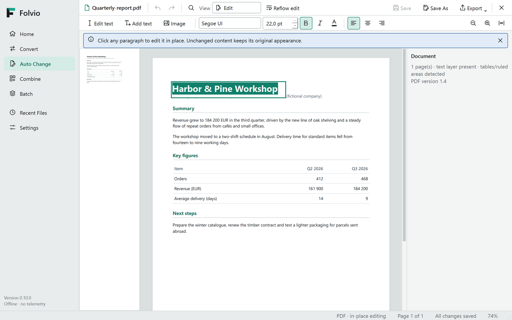
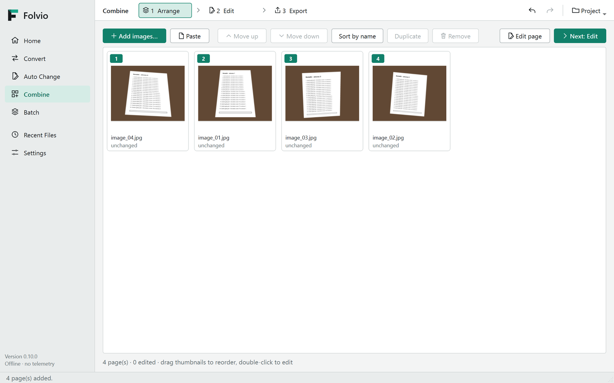
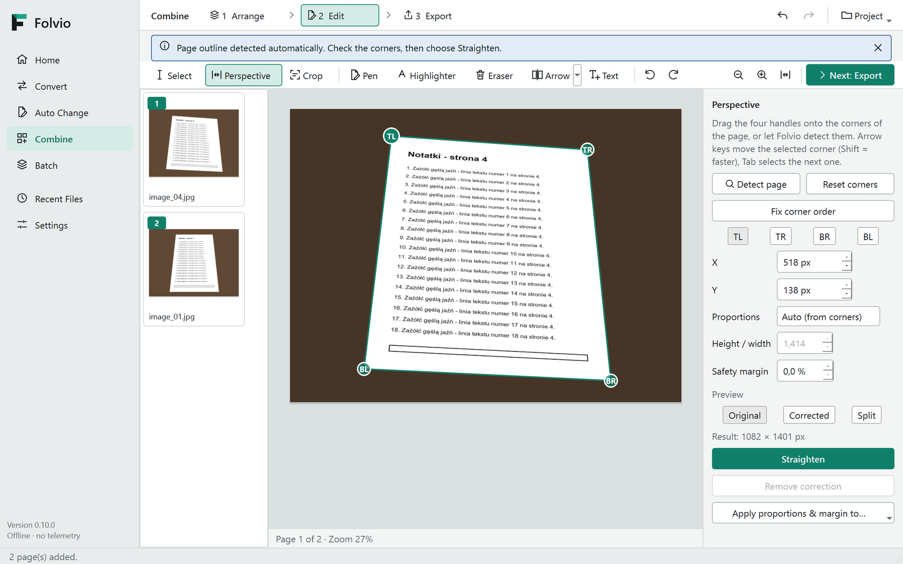
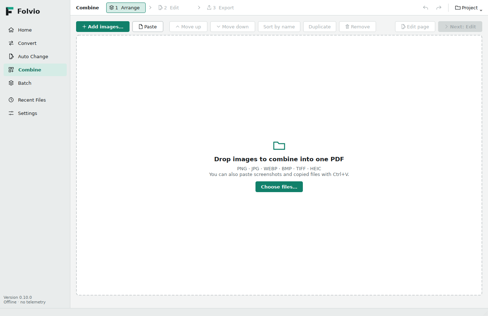

<p align="center">
  
</p>

<h1 align="center">Folvio</h1>

<p align="center">
  <b>Convert, edit and combine files in one desktop workspace.</b><br>
  Native PDF text editing · file conversion · OCR · photos of paper pages to PDF — offline, on Windows and Linux.
</p>

<p align="center">
  <a href="https://github.com/twivo1/Folvio/releases/latest"></a>
  <a href="https://github.com/twivo1/Folvio/actions/workflows/ci.yml"></a>
  
  <a href="LICENSE"></a>
</p>

<p align="center">
  <a href="https://github.com/twivo1/Folvio/releases/latest"><b>Download</b></a> ·
  <a href="#installation">Installation</a> ·
  <a href="#supported-formats">Formats</a> ·
  <a href="#limitations">Limitations</a>
</p>



## Screenshots

| | |
|---|---|
|  **Home** — start from a file or a task |  **Convert** — only conversions the installed engines can really do are offered |
|  **Combine · Arrange** — drop or paste images, reorder pages |  **Combine · Perspective** — four corner handles, automatic page detection |
|  **Combine · Edit** — straightened page with highlighter, arrow, frame and text |  **Combine · Export** — page size, orientation, margins and quality (dark theme) |
|  **Settings** — engines, backups, privacy |  **Linux** — the same application on Ubuntu 26.04 (.deb package) |

All screenshots are taken from the real application with fictional sample documents.

## Features

- **Native PDF editing (Auto Change)** — click a paragraph of an existing PDF, change the text, press `Ctrl+S`.
  Only the changed text objects are rewritten; everything else stays byte-for-byte identical. Saving goes
  through a backup, a temporary file, a full verification of the new PDF and an atomic replace.
- **Universal conversion** — documents, spreadsheets, presentations, images, audio and video. Every output is
  opened and checked, not just the exit code of a tool.
- **OCR** — adds an invisible, searchable text layer to scanned PDFs (Polish and English data included).
- **Combine** — turn photos of paper pages, screenshots and scans into one PDF: drag & drop or `Ctrl+V`,
  reorder, real perspective correction with four handles and automatic page detection, crop, and an
  integrated annotation editor (pen, highlighter, shapes, arrows, text), all non-destructive with undo.
- **Batch** — many files, one target format, parallel jobs with progress, cancel and retry.
- **Reflow editing** — Word-like editing of DOCX/ODT/RTF/Markdown/HTML/TXT.
- **Offline-first** — no account, no telemetry, no uploads. Nothing leaves your computer.

## Installation

Download the files from the [latest release](https://github.com/twivo1/Folvio/releases/latest). Each release
lists SHA-256 checksums in `SHA256SUMS.txt`.

### Windows 10 / 11 (x64)

1. Download **`Folvio-Setup-<version>-Windows-x64.exe`** and run it.
2. Follow the wizard. No administrator rights are needed (installs for the current user); a desktop shortcut
   is offered.
3. Start **Folvio** from the Start menu or the desktop.

The installer is not code-signed yet, so Windows SmartScreen may show *“Windows protected your PC”*:
choose **More info → Run anyway**. Uninstall from *Settings → Apps*; your settings and backups in
`%LOCALAPPDATA%\Folvio` are kept.

PDF editing, Combine, image and Markdown conversion and OCR language data work right after installation.
Audio/video, office documents and the OCR engine use free external programs: open **Settings → Install
missing engines…** and Folvio installs FFmpeg, LibreOffice and Tesseract with the Windows package manager
(`winget`, one-time download).

### Linux — AppImage (any recent x86_64 distribution)

```bash
chmod +x Folvio-<version>-Linux-x86_64.AppImage
./Folvio-<version>-Linux-x86_64.AppImage
```

Tested on Ubuntu 24.04, Ubuntu 26.04 and Fedora 43 (glibc 2.39 or newer is required). The AppImage uses the
base libraries every desktop has (OpenGL/EGL, fontconfig, GLib, D-Bus, libtiff, X11/Wayland). For media,
office and OCR conversions install the engines from your distribution, for example:

```bash
sudo apt install ffmpeg tesseract-ocr libreoffice-writer libreoffice-calc libreoffice-impress   # Ubuntu/Debian
sudo dnf install ffmpeg-free tesseract libreoffice-writer libreoffice-calc libreoffice-impress  # Fedora
```

*Troubleshooting:* if the AppImage does not start because FUSE is missing, run it with
`--appimage-extract-and-run`, or install `fuse3`.

### Ubuntu 24.04+ — .deb package

```bash
sudo apt install ./Folvio-<version>-Ubuntu-amd64.deb
```

Folvio appears in the application menu. `apt` also installs FFmpeg, Tesseract, LibreOffice and the
metric-compatible fonts as recommended packages (skip them with `--no-install-recommends`).
Uninstall with `sudo apt remove folvio` — your data in `~/.local/share/Folvio` is kept.

### Check an installation

`folvio --selftest` (Linux) or, on Windows,
`"%LOCALAPPDATA%\Programs\Folvio\Folvio.exe" --selftest --selftest-report selftest.txt` runs real operations — Combine 3 PNG → PDF,
PDF edit and save, image/Markdown conversion and, when the engines are present, MP4 → MP3,
HTML → DOCX → PDF → DOCX and OCR — and writes a report (exit code 0 = everything passed). It never touches your settings or files.

## Usage

**Edit an existing PDF** — *Auto Change* → open the PDF → click a paragraph → type → `Ctrl+Enter` → `Ctrl+S`.
The original is replaced only after the new file has been verified; a backup is kept.

**Convert a video to audio** — *Convert* → choose the `.mp4` → **MP3** → **Convert**. The bitrate can be
chosen under *Options*.

**Combine scanned images into one PDF** — *Combine* → drop the photos or paste a screenshot with `Ctrl+V` →
drag thumbnails into order → *Edit*: **Perspective** (corners are detected automatically) → **Straighten** →
annotate if needed → *Export* → **Export to PDF…**.

## Supported formats

| Category | From | To | Engine | Windows | Linux |
|---|---|---|---|---|---|
| PDF editing | PDF | PDF (in place) | PDFium (built in) | ✔ | ✔ (Liberation/Carlito fonts substitute Windows fonts) |
| PDF → images | PDF | PNG, JPG | PDFium | ✔ | ✔ |
| Images → PDF / Combine | PNG, JPG, WEBP, BMP, TIFF, GIF | PDF | Qt + PDFium + OpenCV | ✔ | ✔ (TIFF uses the system libtiff) |
| Images | PNG, JPG, WEBP, BMP, TIFF, GIF, SVG | PNG, JPG, WEBP, BMP, TIFF | Qt | ✔ | ✔ |
| HEIC / AVIF | HEIC, AVIF ↔ PNG, JPG | | FFmpeg | ✔ | ✔ (needs a FFmpeg build with the decoders) |
| Documents | DOCX, DOC, ODT, RTF, TXT, HTML | PDF, DOCX, DOC, ODT, RTF, TXT, HTML | LibreOffice | ✔ | ✔ |
| PDF → Word | PDF | DOCX, ODT | Word (if installed) or LibreOffice | ✔ Word: flowing text | ✔ LibreOffice: positioned text boxes |
| Spreadsheets | XLSX, XLS, ODS, CSV | PDF, XLSX, ODS, CSV | LibreOffice | ✔ | ✔ |
| Presentations | PPTX, PPT, ODP | PDF, PPTX, ODP | LibreOffice | ✔ | ✔ |
| Data & text | CSV ↔ JSON, Markdown → HTML/PDF/TXT, HTML → Markdown/TXT | | built in | ✔ | ✔ |
| Video | MP4, MKV, MOV, AVI, WEBM | MP4, MKV, MOV, AVI, WEBM, GIF, frames | FFmpeg | ✔ | ✔ |
| Audio | MP3, WAV, FLAC, M4A, OGG (and audio from video) | MP3, WAV, FLAC, M4A, OGG | FFmpeg | ✔ | ✔ |
| OCR | scanned PDF | searchable PDF | Tesseract (pol + eng data bundled) | ✔ | ✔ |

Conversions appear only when the engine they need is installed.

## Architecture

C++20 and Qt 6.10 Widgets. PDFs are rendered, analysed and edited with **PDFium**; Combine's perspective
correction and page detection use **OpenCV** (`core`, `imgproc`). External engines — LibreOffice, FFmpeg,
Tesseract and, on Windows, Microsoft Word — run as separate processes in job objects (Windows) or process
groups (Linux) with timeouts and complete cancellation. Saving uses a crash-safe writer
(temporary file → verification → atomic replace). Details: [docs/ARCHITECTURE.md](docs/ARCHITECTURE.md),
[docs/COMBINE.md](docs/COMBINE.md).

## Privacy

Folvio works entirely on your computer: no account, no telemetry, no uploads, no update checks. It stores
locally only settings, recent file paths, conversion history (paths and status), backups of files it
overwrote and, while a document has unsaved edits, a recovery file. The only network access is the optional
engine installation you start yourself (Windows: `winget`). Macros in office documents are never run.

## Limitations

- **PDF editing** rewrites the changed lines only. Text that grows beyond the space of its paragraph is
  refused rather than overlapping other content. Scanned pages can get an OCR layer but not text editing.
- **Fonts**: when the embedded font lacks a character, a system font is used for the changed line (on Linux
  the metric-compatible Liberation, Carlito and DejaVu fonts that Folvio ships).
- **OCR** quality depends on scan quality; only Polish and English data are included.
- **Reflow editing** of PDFs reconstructs the document and is not lossless.
- **PDF → DOCX** without Microsoft Word (always on Linux) keeps the layout with positioned text boxes, which
  are less convenient to edit than Word's flowing paragraphs.
- **Codecs** depend on the FFmpeg build you install (e.g. H.265 encoding needs a build with x265).
- **Platforms**: Linux packages are x86_64 only and need glibc 2.39+ (Ubuntu 24.04, Fedora 40 or newer);
  the Windows installer is not code-signed yet.

More in [docs/LIMITATIONS.md](docs/LIMITATIONS.md).

## Build from source

The commands below are the ones the release pipeline runs.

**Linux** (Docker; produces the AppImage and the .deb in `dist/linux/` after running all tests):

```bash
docker build -t folvio-build packaging/linux
docker run --rm -v "$PWD:/src" -w /src folvio-build packaging/linux/build_linux.sh
```

**Windows** (PowerShell; installs Qt 6.10, MinGW 13.1, CMake, Ninja and Inno Setup, then builds, tests and
creates the installer in `dist\`):

```powershell
powershell -ExecutionPolicy Bypass -File packaging\windows\install_toolchain.ps1 -Root C:\Qt
powershell -ExecutionPolicy Bypass -File packaging\build_release.ps1 -QtDir C:\Qt\6.10.0\mingw_64 -QtTools C:\Qt\Tools
```

Tests: `build/release/tests/folvio_tests` — see [docs/TESTING.md](docs/TESTING.md).

## Contributing

Bug reports and pull requests are welcome — see [CONTRIBUTING.md](CONTRIBUTING.md). Please never attach
private documents to issues; describe the problem or share a file you created for the purpose.

## Licence

Folvio is released under the [MIT licence](LICENSE) © 2026 Bartosz Skrzypiec. Bundled third-party components
(Qt under LGPL-3.0, PDFium, OpenCV, fonts, OCR data) keep their own licences — see
[THIRD_PARTY_LICENSES.md](THIRD_PARTY_LICENSES.md).

## Releases

Downloads and release notes: [github.com/twivo1/Folvio/releases](https://github.com/twivo1/Folvio/releases).
Every release is built, tested and verified on clean systems by GitHub Actions
([release workflow](.github/workflows/release.yml)).
