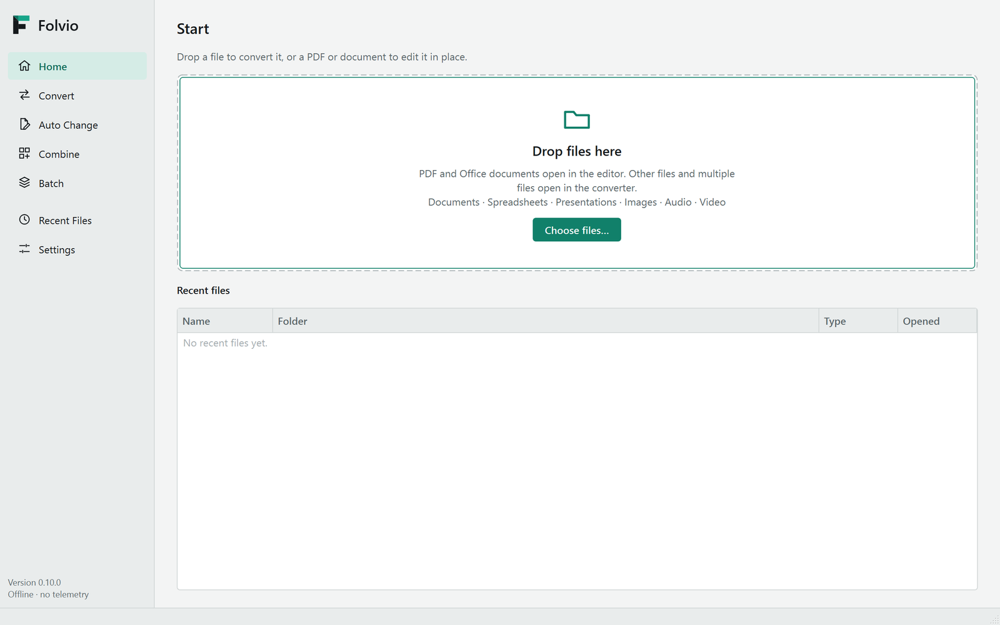
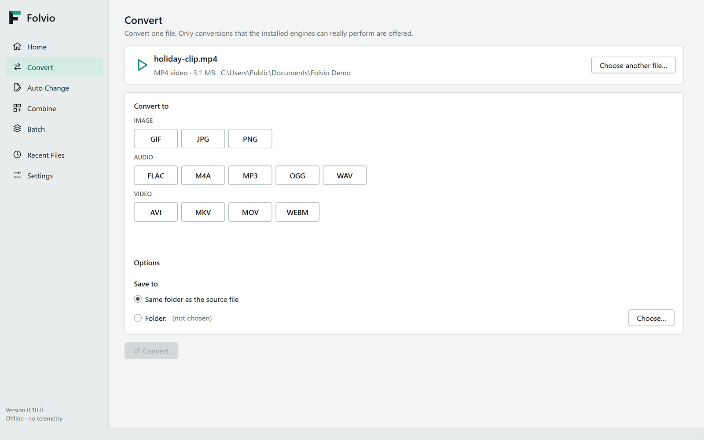
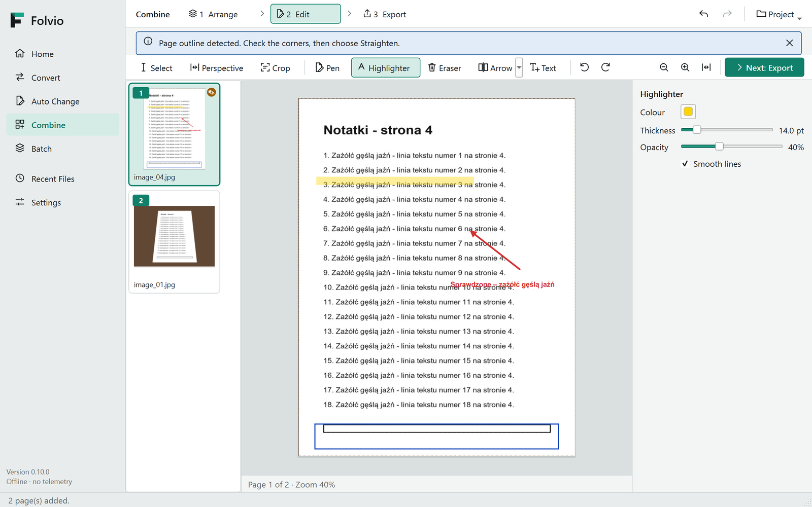
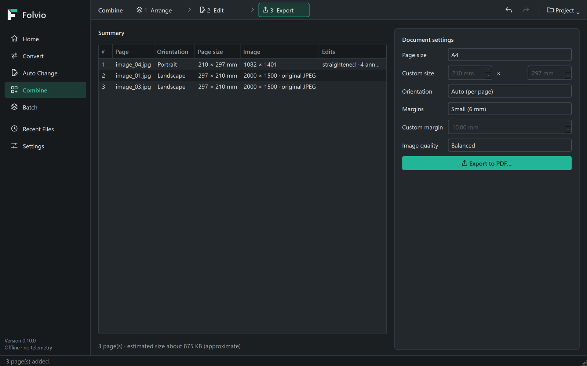
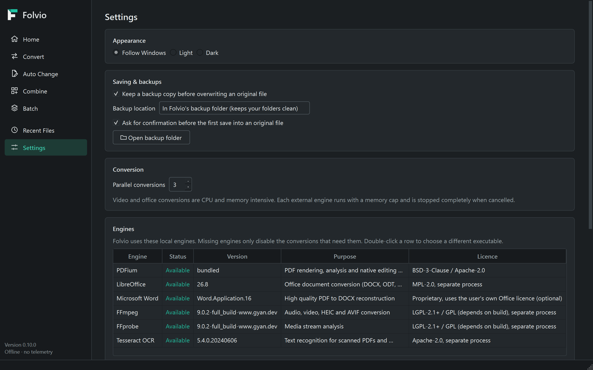

<p align="center">
  
</p>

<h1 align="center">Folvio</h1>

<p align="center">
  <b>Convert, edit and combine files in one desktop workspace.</b><br>
  Native PDF text editing · file conversion · OCR · photos of paper pages to PDF — offline, on Windows and Linux.
</p>

<p align="center">
  <a href="https://github.com/twivo1/Folvio/releases"></a>
  <a href="https://github.com/twivo1/Folvio/actions/workflows/ci.yml"></a>
  
  <a href="LICENSE"></a>
</p>

<p align="center">
  <a href="https://github.com/twivo1/Folvio/releases"><b>Download</b></a> ·
  <a href="#installation">Installation</a> ·
  <a href="#supported-formats">Formats</a> ·
  <a href="#limitations">Limitations</a>
</p>


## Screenshots

| | |
|---|---|
|  **Home** — start from a file or a task |  **Convert** — only conversions the installed engines can really do are offered |
|  **Combine · Arrange** — drag a page; the line shows where it will land |  **Combine · Perspective** — four independent corners on a photographed page |
|  **Combine · Edit** — straightened page with highlighter, arrow, frame and text |  **Combine · Export** — page size, orientation, margins and quality (dark theme) |
|  **Settings** — engines, backups, privacy |  **Linux** — the same application on Ubuntu 26.04 (.deb package) |

All screenshots are taken from the real application with fictional sample documents.

## Features

- **Native PDF editing (Auto Change)** — click a paragraph of an existing PDF, change the text, press `Ctrl+S`.
  Only the changed text objects are rewritten; everything else stays byte-for-byte identical. Saving goes
  through a backup, a temporary file, a full verification of the new PDF and an atomic replace.
- **Universal conversion** — documents, spreadsheets, presentations, images, audio and video. Every output is
  opened and checked, not just the exit code of a tool.
- **OCR** — adds an invisible, searchable text layer to scanned PDFs (Polish and English data included).
- **Screenshots and images (Auto Change)** — `Ctrl+V` a screenshot to annotate it, recognise its text, convert
  it to PDF or export it as an image; paste an image into an open PDF and move, resize, crop or delete it.
- **Recognize Text** — select an area of a photo or screenshot to get editable text: printed (Tesseract) or
  handwriting (**experimental**, PaddleOCR PP-OCRv6, offline; optional 31 MB download you approve first).
  Insert it as a text box or replace the area — always previewed, the original photo is kept.
- **Combine** — turn photos of paper pages, screenshots and scans into one PDF: drag & drop or `Ctrl+V`,
  reorder, real perspective correction with four handles and automatic page detection, crop, and an
  integrated annotation editor (pen, highlighter, shapes, arrows, text), all non-destructive with undo.
- **Batch** — many files, one target format, parallel jobs with progress, cancel and retry.
- **Reflow editing** — Word-like editing of DOCX/ODT/RTF/Markdown/HTML/TXT.
- **Offline-first** — no account, no telemetry, no uploads. Nothing leaves your computer.

## Installation

### Quick start

The download links below target the latest stable release. Until the first release is published,
use the [build instructions](#build-from-source) or check the [release list](https://github.com/twivo1/Folvio/releases).

| System | Steps |
|---|---|
| **Windows 10 / 11** | [Download the installer](https://github.com/twivo1/Folvio/releases/latest/download/Folvio-Setup-Windows-x64.exe) → run it → open **Folvio** from the Start menu |
| **Linux Mint 22 / Ubuntu 24.04 or newer** | [Download the .deb](https://github.com/twivo1/Folvio/releases/latest/download/folvio_amd64.deb) → open it with the package installer → open **Folvio** from the menu |
| **Other Linux (x86_64)** | [Download the AppImage](https://github.com/twivo1/Folvio/releases/latest/download/Folvio-x86_64.AppImage) → allow executing → double-click |

All files of every version, with SHA-256 checksums (`SHA256SUMS.txt`), are on the
[Releases page](https://github.com/twivo1/Folvio/releases).

### Windows

1. Download **`Folvio-Setup-Windows-x64.exe`** (same file as `Folvio-Setup-<version>-Windows-x64.exe`) and run it.
2. Follow the wizard. No administrator rights are needed; a desktop shortcut is offered.
3. Start **Folvio** from the Start menu or the desktop.

The installer is not code-signed yet, so SmartScreen may show *“Windows protected your PC”*: choose
**More info → Run anyway**. Uninstall from *Settings → Apps*; your settings and backups are kept.

### Install on Linux Mint / Ubuntu

Recommended for Linux Mint 22.x and Ubuntu 24.04 / 26.04: the `.deb` package (installs into the menu and is
removed cleanly with the system's package tools).

**With the mouse**

1. Download [`folvio_amd64.deb`](https://github.com/twivo1/Folvio/releases/latest/download/folvio_amd64.deb).
2. Open the downloaded file (double-click). On Linux Mint it opens in the system's package installer; on
   Ubuntu right-click → *Open With* → *App Center*. Which program opens `.deb` files depends on the desktop —
   if none offers to install it, use the terminal command below.
3. Click **Install** and enter your password.
4. Start **Folvio** from the application menu.

**In a terminal — one command** (downloads the official package, installs it with `apt` together with the
conversion engines):

```bash
wget -O /tmp/folvio.deb https://github.com/twivo1/Folvio/releases/latest/download/folvio_amd64.deb && sudo apt install /tmp/folvio.deb ffmpeg tesseract-ocr libreoffice-writer libreoffice-calc libreoffice-impress
```

`apt` checks the system: on an unsupported version it stops with an *unmet dependencies* error and installs
nothing. A note that the download was performed *unsandboxed as root* is harmless. Folvio itself runs as your
normal user. Uninstall with `sudo apt remove folvio` (your data in `~/.local/share/Folvio` is kept).

### AppImage (alternative, no installation)

```bash
wget -O ~/Folvio.AppImage https://github.com/twivo1/Folvio/releases/latest/download/Folvio-x86_64.AppImage && chmod +x ~/Folvio.AppImage && ~/Folvio.AppImage
```

Without a terminal: download the AppImage, right-click it → *Properties* → *Permissions* → tick
*Allow executing file as program*, then double-click it. The AppImage does **not** need `libfuse2`; it uses
`fusermount3` from the `fuse3` package, which Mint and Ubuntu install by default. Install the conversion
engines separately (next section).

### System requirements

| System | Package | Status |
|---|---|---|
| Windows 11, Windows 10 1809 or newer (x64) | installer | tested (Windows 11, Windows Server 2025) |
| Linux Mint 22.x (22.1, 22.2) | .deb, AppImage | tested in Linux Mint containers (no full desktop VM) |
| Ubuntu 24.04 LTS, 26.04 LTS | .deb, AppImage | tested (containers, WSLg with Wayland and X11) |
| Fedora 43 | AppImage | tested (container) |
| Other x86_64 distributions with glibc 2.39 or newer | AppImage | expected to work, not tested |
| **Linux Mint 21.x, Ubuntu 22.04** (glibc 2.35), 32-bit or ARM systems | — | **not supported** |

### Optional conversion engines

Folvio installs and runs on its own, but some conversions use free programs that are installed separately
(Folvio does not bundle them because of their licences). Missing engines only hide the conversions that need
them; *Settings → Engines* shows what is available.

| Works right after installation | Needs an engine |
|---|---|
| PDF text editing (Auto Change), Combine (photos → PDF, perspective, annotations), PDF ↔ images, image formats, Markdown/HTML/CSV/JSON conversions, OCR language data (Polish, English) | **FFmpeg** — audio and video, HEIC/AVIF · **LibreOffice** — DOCX, ODT, XLSX, PPTX, PDF → DOCX · **Tesseract** — OCR engine |

| System | Command |
|---|---|
| Linux Mint / Ubuntu | `sudo apt install ffmpeg tesseract-ocr libreoffice-writer libreoffice-calc libreoffice-impress` |
| Fedora | `sudo dnf install ffmpeg-free tesseract libreoffice-writer libreoffice-calc libreoffice-impress` |
| Windows | *Settings → Install missing engines…* (uses `winget`; one-time download) |

`tesseract-ocr-pol` and `tesseract-ocr-eng` are not needed: Folvio brings its own Polish and English data.
On Linux, *Settings → Install missing engines…* shows the right command for your distribution.

### Troubleshooting

| Problem | Solution |
|---|---|
| `GLIBC_2.38' not found` / *unmet dependencies: libc6 (>= 2.38)* | The system is too old (e.g. Linux Mint 21.x, Ubuntu 22.04). Upgrade to Mint 22 / Ubuntu 24.04. |
| AppImage: *fusermount3 … not found* / *Cannot mount AppImage* | `sudo apt install fuse3`, or start it with `~/Folvio.AppImage --appimage-extract-and-run` |
| A conversion is missing / a button is disabled | Install the engine (table above), then *Settings → Detect again* |
| OCR does not work | Install `tesseract-ocr` (Linux) or use *Install missing engines* (Windows) |
| Folvio is not in the menu after installing the .deb | Log out and back in, or run `folvio` in a terminal |
| *Could not load the Qt platform plugin "xcb"* | Run the self-test below and open an issue with its output |

Detailed Linux guide: **[docs/INSTALL_LINUX.md](docs/INSTALL_LINUX.md)**.

### Check an installation

`folvio --selftest` (Linux) or, on Windows,
`"%LOCALAPPDATA%\Programs\Folvio\Folvio.exe" --selftest --selftest-report selftest.txt` runs real operations
(Combine 3 PNG → PDF, PDF edit and save, conversions and — when the engines are present — MP4 → MP3,
HTML → DOCX → PDF → DOCX and OCR) and reports the result (exit code 0 = everything passed). It never touches
your settings or files.

## Usage

**Edit an existing PDF** — *Auto Change* → open the PDF → click a paragraph → type → `Ctrl+Enter` → `Ctrl+S`.
The original is replaced only after the new file has been verified; a backup is kept.

**Turn a screenshot into text** — *Auto Change* → `Ctrl+V` → **Recognize Text** → drag around the text →
correct it in the *Recognized Text* panel → **Copy**, **Insert as Text** or **Replace Selection…**.

**Convert a video to audio** — *Convert* → choose the `.mp4` → **MP3** → **Convert**. The bitrate can be
chosen under *Options*.

**Combine scanned images into one PDF** — *Combine* → drop the photos or paste a screenshot with `Ctrl+V` →
drag thumbnails into order → *Edit*: **Perspective** (corners are detected automatically) → **Straighten** →
annotate if needed → *Export* → **Export to PDF…**.

## Supported formats

| Category | From | To | Engine | Windows | Linux |
|---|---|---|---|---|---|
| PDF editing | PDF | PDF (in place) | PDFium (built in) | ✔ | ✔ (Liberation/Carlito fonts substitute Windows fonts) |
| PDF → images | PDF | PNG, JPG | PDFium | ✔ | ✔ |
| Images → PDF / Combine | PNG, JPG, WEBP, BMP, TIFF, GIF | PDF | Qt + PDFium + OpenCV | ✔ | ✔ (TIFF uses the system libtiff) |
| Images | PNG, JPG, WEBP, BMP, TIFF, GIF, SVG | PNG, JPG, WEBP, BMP, TIFF | Qt | ✔ | ✔ |
| HEIC / AVIF | HEIC, AVIF ↔ PNG, JPG | | FFmpeg | ✔ | ✔ (needs a FFmpeg build with the decoders) |
| Documents | DOCX, DOC, ODT, RTF, TXT, HTML | PDF, DOCX, DOC, ODT, RTF, TXT, HTML | LibreOffice | ✔ | ✔ |
| PDF → Word | PDF | DOCX, ODT | Word (if installed) or LibreOffice | ✔ Word: flowing text | ✔ LibreOffice: positioned text boxes |
| Spreadsheets | XLSX, XLS, ODS, CSV | PDF, XLSX, ODS, CSV | LibreOffice | ✔ | ✔ |
| Presentations | PPTX, PPT, ODP | PDF, PPTX, ODP | LibreOffice | ✔ | ✔ |
| Data & text | CSV ↔ JSON, Markdown → HTML/PDF/TXT, HTML → Markdown/TXT | | built in | ✔ | ✔ |
| Video | MP4, MKV, MOV, AVI, WEBM | MP4, MKV, MOV, AVI, WEBM, GIF, frames | FFmpeg | ✔ | ✔ |
| Audio | MP3, WAV, FLAC, M4A, OGG (and audio from video) | MP3, WAV, FLAC, M4A, OGG | FFmpeg | ✔ | ✔ |
| OCR | scanned PDF | searchable PDF | Tesseract (pol + eng data bundled) | ✔ | ✔ |

Conversions appear only when the engine they need is installed.

## Architecture

C++20 and Qt 6.10 Widgets. PDFs are rendered, analysed and edited with **PDFium**; Combine's perspective
correction and page detection use **OpenCV** (`core`, `imgproc`). External engines — LibreOffice, FFmpeg,
Tesseract and, on Windows, Microsoft Word — run as separate processes in job objects (Windows) or process
groups (Linux) with timeouts and complete cancellation. Saving uses a crash-safe writer
(temporary file → verification → atomic replace). Details: [docs/ARCHITECTURE.md](docs/ARCHITECTURE.md),
[docs/COMBINE.md](docs/COMBINE.md).

## Privacy

Folvio works entirely on your computer: no account, no telemetry, no uploads, no update checks. It stores
locally only settings, recent file paths, conversion history (paths and status), backups of files it
overwrote and, while a document has unsaved edits, a recovery file. The only network access is the optional
engine installation you start yourself (Windows: `winget`) and, if you agree, the one-time download of the
handwriting recognition models from PaddlePaddle's Hugging Face repositories (checked with SHA-256). Images and
notes are recognised on your computer and never uploaded. Macros in office documents are never run.

## Limitations

- **PDF editing** rewrites the changed lines only. Text that grows beyond the space of its paragraph is
  refused rather than overlapping other content. Scanned pages can get an OCR layer but not text editing.
- **Fonts**: when the embedded font lacks a character, a system font is used for the changed line (on Linux
  the metric-compatible Liberation, Carlito and DejaVu fonts that Folvio ships).
- **OCR** quality depends on scan quality; only Polish and English data are included.
- **Handwriting recognition is experimental**: on real handwriting photos about 57 % of words come out exactly
  right; Polish handwriting has not been measured on real samples yet. Always review the result.
- **Reflow editing** of PDFs reconstructs the document and is not lossless.
- **PDF → DOCX** without Microsoft Word (always on Linux) keeps the layout with positioned text boxes, which
  are less convenient to edit than Word's flowing paragraphs.
- **Codecs** depend on the FFmpeg build you install (e.g. H.265 encoding needs a build with x265).
- **Platforms**: Linux packages are x86_64 only and need glibc 2.39+ (Linux Mint 22, Ubuntu 24.04, Fedora 40 or newer; not Mint 21 / Ubuntu 22.04);
  the Windows installer is not code-signed yet.

More in [docs/LIMITATIONS.md](docs/LIMITATIONS.md).

## Build from source

The commands below are the ones the release pipeline runs.

**Linux** (Docker; produces the AppImage and the .deb in `dist/linux/` after running all tests):

```bash
docker build -t folvio-build packaging/linux
docker run --rm -v "$PWD:/src" -w /src folvio-build packaging/linux/build_linux.sh
```

**Windows** (PowerShell; installs Qt 6.10, MinGW 13.1, CMake, Ninja and Inno Setup, then builds, tests and
creates the installer in `dist\`):

```powershell
powershell -ExecutionPolicy Bypass -File packaging\windows\install_toolchain.ps1 -Root C:\Qt
powershell -ExecutionPolicy Bypass -File packaging\build_release.ps1 -QtDir C:\Qt\6.10.0\mingw_64 -QtTools C:\Qt\Tools
```

Tests: `build/release/tests/folvio_tests` — see [docs/TESTING.md](docs/TESTING.md).

## Contributing

Bug reports and pull requests are welcome — see [CONTRIBUTING.md](CONTRIBUTING.md). Please never attach
private documents to issues; describe the problem or share a file you created for the purpose.

## Licence

Folvio is released under the [MIT licence](LICENSE) © 2026 Bartosz Skrzypiec. Bundled third-party components
(Qt under LGPL-3.0, PDFium, OpenCV, fonts, OCR data) keep their own licences — see
[THIRD_PARTY_LICENSES.md](THIRD_PARTY_LICENSES.md).

## Releases

Downloads and release notes: [github.com/twivo1/Folvio/releases](https://github.com/twivo1/Folvio/releases).
Every release is built, tested and verified on clean systems by GitHub Actions
([release workflow](.github/workflows/release.yml)).
